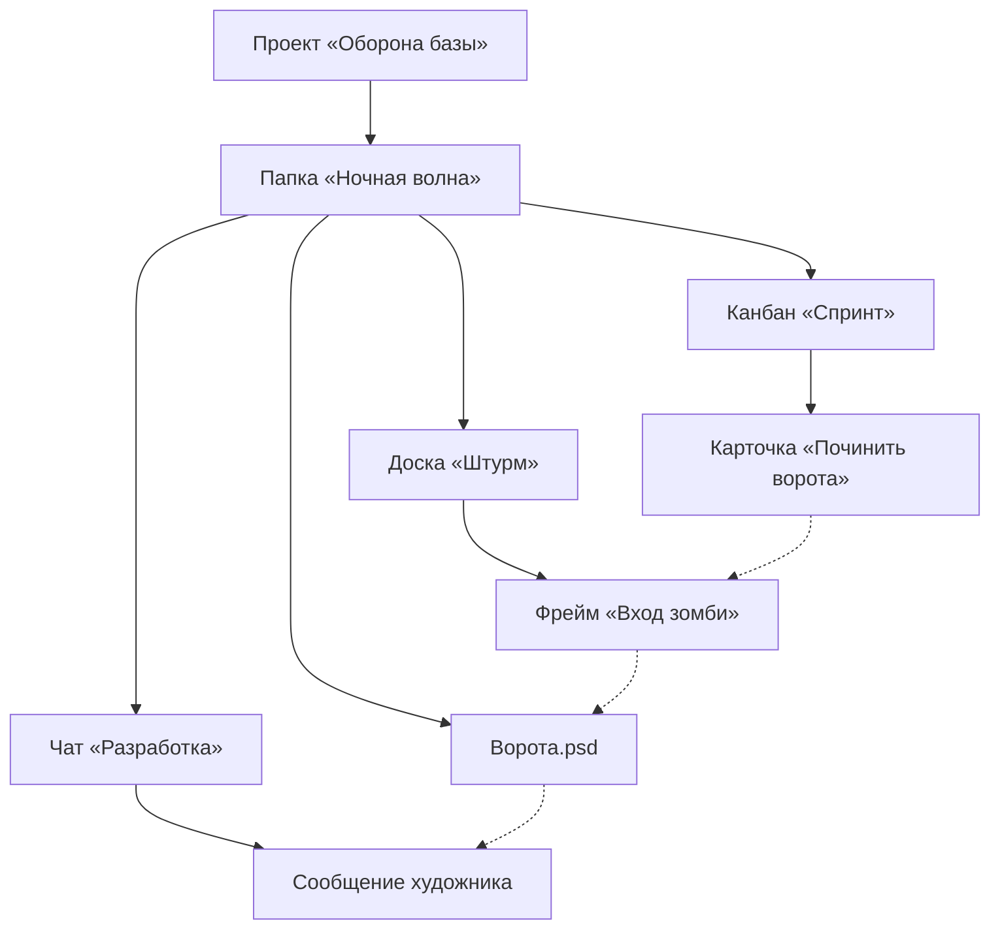

# DreamTeam — техническое задание

**Редакция 1.0 от 22 ноября 2026 года.** Рабочее пространство небольшой команды. Клиент публикуется на GitHub Pages. Документ задаёт поведение продукта, выбор инфраструктуры, порядок реализации и условия приёмки.

**Что должно получиться.** Разработчик открывает задачу «Починить ворота», переходит к нужной схеме на доске, из схемы открывает макет, а из макета — сообщение, где утвердили вариант. Художник в это время видит, что задача перешла в работу. Через неделю команда может выгрузить проект, развернуть его в другом месте и пройти тот же путь.

**Навигация.** [Состав поставки](#scope) · [Иерархия и права](#objects) · [Рабочие модули](#modules) · [Надёжный канбан](#sync) · [Предпросмотр файлов](#preview) · [Формат и перенос](#exchange) · [Интеграции](#integrations) · [Архитектура и стоимость](#architecture) · [План разработки](#plan) · [Приёмка](#acceptance).

<a id="scope"></a>

## 1. Состав поставки

| Рубеж | Что получает команда | Условие перехода |
|---|---|---|
| Первый рабочий сценарий | Вход по приглашению, проект и папка, канбан, два одновременно работающих участника | Карточка меняет место ровно один раз при потере ответа, обновлении вкладки и повторной отправке |
| Внутренний пилот | Канбан, свободная доска, календарь с напоминаниями, чат, файлы, документы DreamTeam, ссылки и поиск. Базовый просмотр и перенос проекта | Команда ведёт один проект неделю. Успешны сквозной сценарий, восстановление из копии и отзыв доступа гостя |
| Версия 1.0 | Перенос объектов по отдельности и пакетами, широкий предпросмотр, открытые форматы, обмен с Obsidian, контроль квот и восстановление после сбоев | Пройдены проверки раздела 10, в том числе открытие настоящих DOC и PSD прямо на сайте |
| Дальнейшее развитие | Обмен через API дисков, уведомления Discord, согласования, реестры, отчёты и другие деловые модули | Каждый модуль включается отдельно и использует общие права, ссылки и экспорт |

**Покрытие 1С.** Ближайший ориентир для первой версии — совместная работа из «1С:Документооборота». Поручения, исполнители, сроки, файлы, версии, обсуждение и история входят в базовый продукт. Маршруты согласования, регистрация документов, учёт времени и другие деловые процессы получают отдельные этапы в разделе 9. Для паритета с конкретной конфигурацией 1С потребуется её название и список рабочих операций. Регламентированная бухгалтерия, зарплата, электронная подпись и сдача отчётности требуют собственных требований и приёмки. [Возможности 1С:Документооборота][1c]

**Расчётный профиль.** Для проектирования принят пилот на 5–15 человек. Для замеров — 10 одновременных пользователей, 1 000 карточек на канбане, 2 000 элементов на холсте и 50 000 сообщений в проекте. Это размеры испытательного набора. Сроки и объёмы команды уточняются по первым двум этапам.

<a id="objects"></a>

## 2. Иерархия, ссылки и доступ

### 2.1. Где живёт объект

Команда владеет проектами. У проекта есть корневая папка. Папки вкладываются друг в друга и содержат ресурсы любого рабочего модуля. В дереве показываются название, тип и путь. Внутри открытого ресурса видны его собственные уровни.

| Контейнер | Что в нём находится | Что можно открыть по постоянной ссылке |
|---|---|---|
| Команда → проект → папка | Люди и роли команды, проекты, вложенные папки и ресурсы | Проект, папку или ресурс |
| Канбан → колонка | Упорядоченные карточки, их подзадачи, чек-листы и комментарии | Карточку, колонку, комментарий |
| Свободная доска | Фреймы, стикеры, схемы и связанные объекты | Всю доску, фрейм или конкретный элемент с наведением камеры |
| Календарь | Разовые и повторяющиеся события, отдельные вхождения серии | Событие или вхождение на конкретную дату |
| Чат → канал | Сообщения, ответы и ветки | Конкретное сообщение с прокруткой и контекстом |
| Файл или документ DreamTeam | Неизменяемые версии файла, заметки к нему либо редактируемые блоки документа | Файл, определённую версию, страницу PDF или блок документа |

У объекта один родитель и постоянный UUID. Ярлык, ссылка в тексте и представление «Мои задачи» показывают тот же объект. Переименование и перемещение внутри проекта сохраняют его адрес. Цикл в дереве запрещён. Для переноса между проектами проверяются права на всё поддерево и показывается, кто получит или потеряет доступ. Между командами используется импорт копии с новыми идентификаторами.

### 2.2. Как связать задачу, схему, файл и разговор

В проекте «Оборона базы» есть папка «Ночная волна». В ней лежат канбан «Спринт», доска «Штурм», файл «Ворота.psd» и чат «Разработка». Карточка «Починить ворота» ссылается на фрейм «Вход зомби». Элемент фрейма открывает макет. На панели файла прикреплена ссылка «Почему выбрали вариант Б», ведущая к сообщению художника. Для PDF такая заметка может быть привязана к странице и версии. Бинарное содержимое PSD при добавлении заметки сохраняется побайтно.



Сплошные линии показывают принадлежность, пунктир — переходы по ссылкам. Пользователь вставляет ссылку из буфера или через поиск по `[[`. На панели «Связи» видны исходящие и обратные ссылки с доступными названиями и контекстом. Маршрут вида `/DreamTeam/#/t/<teamId>/o/<objectId>?anchor=<anchorId>` открывается из новой вкладки. После входа приложение восстанавливает нужный экран. Для файла можно выбрать «последняя версия» или зафиксировать версию.

Удаление отправляет объект и его поддерево в корзину на 30 дней. Ссылки сохраняются. При восстановлении они снова ведут к объекту с тем же ID. При окончательном удалении доступная источнику ссылка обозначает недоступную цель. Смена прав скрывает имя, миниатюру, текст и обратные ссылки закрытого объекта. Для удалённой цели и отсутствия доступа посторонний получает одинаковый экран. Если пользователь сам написал в открытом тексте название или цитату, этот текст подчиняется правам исходного документа.

### 2.3. Кто что может делать

| Роль | Область | Действия |
|---|---|---|
| Владелец команды | Вся команда | Назначает администраторов, задаёт политику доступа и квоты, настраивает инфраструктуру, экспортирует и восстанавливает пространство. Перед уходом передаёт владение |
| Администратор команды | Вся команда | Ведёт проекты, участников и приглашения, восстанавливает из корзины, читает журнал. Передача владения и удаление команды доступны владельцу |
| Руководитель проекта | Назначенные проекты | Управляет структурой и составом проекта, настройками модулей и экспортом проекта |
| Участник | Доступные проекты и папки | Создаёт и редактирует рабочие материалы, перемещает карточки, ведёт обсуждения, выгружает доступные объекты |
| Гость | Явно выданный проект, папка или объект | Читает либо комментирует согласно выданному разрешению. По умолчанию скачивание оригиналов и экспорт выключены |

Проект по умолчанию закрыт. Папки и объекты наследуют доступ. Руководитель может разорвать наследование и задать свой список. При открытии ссылки решение принимается для самой цели. Владелец и администратор команды — доверенные роли с доступом ко всем проектам команды. Для обычного участника создание публичной ссылки выключено. Гостю можно дать доступ к одному объекту без раскрытия соседей и полного пути. Право на скачивание управляет выдачей оригинала. Показанное на экране содержимое получатель может сохранить.

Владелец приглашает по одноразовой ссылке с ролью, областью и сроком действия, по умолчанию семь дней. Вход подтверждает личность, сервер проверяет адрес приглашённого, срок и отзыв, затем однократно принимает приглашение. Для пилота — одноразовая ссылка входа на email через настроенный SMTP. При включённом OAuth пользователь возвращается на тот же объект. Отзыв участия закрывает API, новые ссылки на файлы, поиск, подписки, уведомления и экспорт. Список активных сеансов и выход со всех устройств доступны в профиле. [Ограничения штатной почты Supabase][smtp]

<a id="modules"></a>

## 3. Рабочие модули

| Модуль | Что делает пользователь | Правила, которые влияют на реализацию |
|---|---|---|
| Рабочее пространство | Переключает команды и проекты, создаёт папки, помечает избранное, видит недавнее, «Мои задачи» и входящие | Главная сразу показывает работу. Содержимое ветви дерева загружается при раскрытии. На телефоне навигация сворачивается, редактор и объект открываются на весь экран |
| Канбан | Создаёт и переименовывает колонки, меняет их порядок, перетаскивает карточку мышью, касанием или командой «Переместить». Фильтрует по человеку, метке, сроку, статусу | У карточки есть заголовок, описание, исполнители, приоритет, срок, метки, подзадачи, чек-лист, комментарии, вложения, связи и история. Фильтры, группировка по исполнителю и табличный вид используют общий ID. Удаление непустой колонки предлагает перевод карточек в выбранную колонку либо явную архивацию |
| Свободная доска | Панорамирует и масштабирует холст, размещает текст, стикеры, фигуры, стрелки, изображения, фреймы и ссылки. Выделяет, группирует, выравнивает, отменяет своё действие | На схемах можно открыть связанную карточку и вернуться к тому же масштабу. Изменения передаются по элементам. Курсоры других людей временные, подписка действует только на открытом холсте. Коллизия правок одного элемента сохраняет доступную автору версию |
| Календарь | Переключает месяц, неделю и список, создаёт встречу, задаёт участников, место, часовой пояс, повтор и несколько напоминаний. Отменяет одно вхождение или всю серию | Срок карточки — отдельный слой. Изменение срока в календаре обновляет карточку. Событие «весь день» хранит календарную дату. Встреча хранит момент UTC и зону IANA. У повторов сохраняются местное время, правило и исключения, включая переходы летнего времени |
| Чат | Создаёт канал проекта, отправляет сообщения и файлы, отвечает, редактирует своё сообщение, ставит реакции, упоминает участника, закрепляет решение | Статусы отправки и повтора видимы. Повтор запроса возвращает исходный ID. История загружается страницами. Постоянная ссылка открывает соседние сообщения. Метка прочитанного ведётся на человека и канал. Исключение пользователя прекращает доставку |
| Хранилище | Загружает один или несколько файлов в папку, видит размер, автора, тип, прогресс и квоту, открывает просмотр, загружает новую версию, сравнивает метаданные и скачивает оригинал | У файла стабильный ID, у версии — собственный ID и SHA-256. Повтор после обрыва продолжает загрузку, если это поддерживает адаптер. На отказе видны причина и способ повтора. Ссылка без закреплённой версии открывает текущую |
| Документ DreamTeam | Пишет заметку или ТЗ с заголовками, списками, таблицами, чек-листами и блоками-ссылками. Добавляет обсуждение к блоку, открывает историю, восстанавливает версию | Каждому блоку присваивается ID. Сохранение проверяет версию изменённых блоков. При совпадении правок одного блока автор видит оба текста и выбирает результат. Индикатор показывает «черновик на устройстве», «синхронизация» или «сохранено» |
| Поиск и входящие | Ищет по названиям, текстам документов, карточкам и сообщениям. Ограничивает результаты командой, проектом, папкой, типом, автором или датой. Из результата переходит к блоку или сообщению | Поиск по-русски, по началу слова и точному имени файла. В версии 1.0 добавляется извлечённый текст поддержанных PDF и Office. Упоминания, назначения, ответы и напоминания попадают в единый центр. Можно отключить канал, выбрать тихие часы и пометить всё прочитанным |

**Интерфейс.** Боковое дерево и хлебные крошки показывают местоположение, центральная область содержит открытый ресурс, боковая панель — свойства, связи и историю. Тёмная тема по умолчанию. Пустой экран предлагает первое действие для выбранного типа. У сохранения, потери сети, конфликта и отказа в доступе разные состояния. Все основные команды работают с клавиатуры, фокус виден, статус обозначен текстом. Модульные настройки живут рядом с ресурсом.

**Напоминания при закрытой вкладке.** В транзакции с изменением события создаётся или пересчитывается расписание. Планировщик каждую минуту выбирает наступившие записи, проверяет актуальную версию и права получателя, создаёт запись во входящих и запускает Web Push. Ключ доставки включает получателя, серию, исходное время вхождения, смещение и канал. Повторный запуск сохраняет одно логическое уведомление. Перенос встречи снимает старое задание, отмена прекращает будущие отправки. После тихих часов доставляется сводка. Центр входящих доступен и при запрете системных уведомлений. Срок обработки сервером и фактическое появление системного уведомления измеряются отдельно. Для iOS/iPadOS предусмотрено объяснение установки на домашний экран и включения разрешения. [Планировщик][cron] · [Web Push][push] · [Поддержка на iOS и iPadOS][ios]

<a id="sync"></a>

## 4. Перемещение карточки и синхронизация

**Инвариант.** В канбане существует одна запись карточки. Её родитель задаёт колонку, а ключ сортировки — позицию среди соседей. Клиент хранит карточки по ID. Обе колонки, панель карточки и «Мои задачи» читают один экземпляр записи. Зеркала и ярлыки отмечаются явно.

1. В момент отпускания клиент сохраняет намерение в локальной очереди IndexedDB и сразу меняет положение карточки на экране. Команда `move_card` содержит `op_id`, ID карточки, целевую колонку, ID соседей и ожидаемую версию позиции. Очередь и локальное состояние записываются вместе. Пока вкладка открыта без сети, карточка видна на новом месте со знаком ожидания.
2. Сервер устанавливает пользователя по сеансу и проверяет права на карточку, исходную и целевую колонки. Для одного пользователя и `op_id` действует уникальное ограничение. Повтор той же команды получает сохранённый результат. Попытка использовать тот же ключ с другим содержимым отклоняется. Проверка действующего доступа выполняется и при повторе.
3. Одна транзакция блокирует затронутые колонки в порядке ID и проверяет версию позиции карточки. Соседи разрешаются по их текущим ID. Если остался один — вставка рядом с ним, если исчезли оба — в конец с указанием скорректированной позиции. Сервер вычисляет ключ между соседями. При исчерпании интервала перенумеровывает только целевую колонку под той же блокировкой. Результат, новая версия и запись журнала фиксируются одной транзакцией. Карточка не создаётся заново.
4. Клиент обрабатывает HTTP-ответ и событие подписки в любом порядке. Совпавший `op_id` подтверждает локальное действие. Состояние старее уже применённой версии пропускается. Следующие локальные действия пользователя остаются наложенными на подтверждённое состояние. Для последовательных переносов одной карточки новая команда отправляется после результата предыдущей, с уточнённой версией. При отказе интерфейс снимает признак ожидания и сохраняет текстовый черновик, если он был.
5. После возврата сети клиент читает изменения после подтверждённого курсора, сверяет очередь, повторяет непринятые команды с прежними ключами и восстанавливает подписку с перекрытием на время догрузки. Снимок и его курсор соответствуют одному состоянию БД. Курсор выдаётся журналом проекта в порядке фиксации транзакций. Пуш-событие лишь ускоряет доставку. При просроченном курсоре загружается новый снимок и поверх него сверяются ожидающие команды.

| Ситуация | Что увидят люди |
|---|---|
| Ответ потерялся после сохранения, пользователь обновил страницу | Очередь переживает перезагрузку. Повтор даёт одну карточку в правильной колонке и одну запись о переносе |
| Два человека перетащили одну карточку в разные колонки с одной версии | Первый зафиксированный перенос принят. Второй получает конфликт, видит актуальное место и действие «Переместить сюда всё равно», которое отправляет новую команду с новой версией |
| Два человека вставили разные карточки между теми же соседями | Обе карточки сохраняются по одной. Транзакции устанавливают однозначный порядок. После синхронизации он совпадает у всех |
| Один меняет описание, другой переносит карточку | Версии содержания и позиции независимы. Обе правки сохраняются |
| Пока автор был офлайн, колонку удалили или отозвали права | Операция получает понятный отказ. При удалённой колонке доступен выбор нового места. При отзыве прав рабочие данные удаляются из кэша при следующей связи |

Команда «Отменить перенос» создаёт обратное перемещение с проверкой текущей версии. Если коллега уже успел передвинуть эту карточку, приложение покажет его изменение до повторного действия автора. Перетаскивание за пределы допустимой зоны, отменённое клавишей Escape, завершает жест без записи в БД.

**Границы офлайн-режима.** Доступны ранее открытые ресурсы при разрешённом локальном хранении, переносы, обычные правки и черновики сообщений. Изменения прав, приглашения, запуск экспорта всей команды и отправка внешним сервисам требуют сети. Очередь разделена по пользователю и команде, синхронизация нескольких вкладок использует одну очередь с арендой на отправку. Дублированный отправитель безопасен благодаря серверному ключу. Срок автоматического повтора — семь дней, квитанции операций хранятся минимум 30 дней. Истёкшие операции показываются для ручной сверки. Общему устройству доступен режим без постоянного приватного кэша.

<a id="preview"></a>

## 5. Файлы и встроенный просмотр

Клик по файлу открывает внутренний просмотрщик с названием, версией, содержимым и панелью связей. Проверка поддержки учитывает сигнатуру, контейнер, кодек и размер. Сначала используется доступная браузеру обработка, затем — разрешённое для команды преобразование. Выбор «Скачать оригинал» доступен при соответствующем праве во всех состояниях. Для обязательных форматов демонстрационный файл должен показать содержимое на сайте.

| Форматы | Что должно отображаться | Способ реализации и границы |
|---|---|---|
| PDF | Страницы, масштаб, переход по номеру, поиск и выделение при наличии текстового слоя | PDF.js, видимые страницы и соседние загружаются по требованию. Скан отображается как страница. Пароль для локального просмотра вводится на устройстве. [PDF.js][pdfjs] |
| DOCX, DOCM | Заголовки, абзацы, списки, таблицы, встроенные изображения. Переключатель «По страницам» для сложной вёрстки | Быстрый семантический просмотр DOCX через Mammoth с очисткой результата. Для разметки страниц и DOCM — производный PDF. Макросы отключены. [Mammoth][mammoth] · [Фильтры LibreOffice][lo] |
| **DOC**, RTF, ODT | Читаемые страницы внутри приложения, включая кириллицу, таблицы и картинки | DOC Word 97–2003 проходит через изолированный LibreOffice → PDF. Тот же путь используется для RTF и ODT. Оригинал и производный файл связаны с одной версией. [Фильтры LibreOffice][lo] |
| XLSX, XLS, ODS | Вкладки листов, адрес ячейки, типизированные значения, числа, даты, текст, формула и её сохранённое значение | SheetJS в Web Worker. Строки выводятся порциями. Если у формулы отсутствует кэш результата, отображается выражение и пояснение. Внешние подключения и макросы отключены. [SheetJS][sheetjs] · [Формулы][formulae] |
| CSV, TSV | Интерактивная таблица с выбором разделителя, кодировки, первой строки и режима заголовков | Потоковый разбор кавычек и переносов строк внутри поля, предпросмотр первых 200 строк, догрузка. Обязательные кодировки UTF-8 с BOM и без него и Windows-1251. Ведущие нули можно сохранить как текст |
| PPTX, PPT, ODP | Миниатюры и просмотр слайдов по порядку | Производный PDF, статическое содержимое слайда. Анимации и встроенное видео доступны в оригинале. [Фильтры LibreOffice][lo] |
| JPEG, PNG, GIF, WebP, AVIF, BMP, ICO, SVG | Вписать в окно, реальный размер и масштаб, для поддержанных анимаций — воспроизведение | Браузерный декодер с проверкой возможностей. SVG проходит очистку или растеризацию. Ошибка декодирования переводит к обработчику конкретного формата. [Форматы браузеров][media] |
| TIFF, HEIC/HEIF | Просмотр изображения, выбор страницы многостраничного TIFF. Для HEIC на неподдерживаемом устройстве — производное изображение | Изолированный декодер или конвертер с проверенным набором кодеков. При сборке прогоняются реальные образцы с камеры и сканера |
| TGA, DDS, фотографический RAW | Для рабочих текстур TGA и двумерных DDS — плоское изображение и размеры. Для RAW (DNG, NEF, CR2/CR3) — встроенное превью при наличии либо результат проявки поддержанного профиля | В версии 1.0 обязательны эталоны TGA и DDS BC1/BC3. Редкие варианты и RAW добавляются через реестр декодеров. В карточке файла указан фактический режим просмотра, включая показ только миниатюры |
| **PSD** | Композитное изображение, дерево доступных слоёв с именами и видимостью, размеры холста | `ag-psd` в Web Worker для поддержанных вариантов. При большом документе или неподдержанном цветовом режиме — приватная миниатюра через конвертер, с пометкой об упрощённом просмотре. Эффекты и шрифты сверяются с сохранённым композитом. Эталон приёмки — многослойный RGB PSD. [Возможности ag-psd][psd] |
| MP3, WAV, FLAC, Ogg/Opus, M4A/AAC | Плеер, длительность и перемотка, при наличии — название трека | Проверка кодека на устройстве. Для заявленного профиля, который браузер не декодирует, конвертер создаёт потоковую копию в поддержанном формате. [Медиаформаты][media] |
| MP4, WebM, MOV | Видео, перемотка и полноэкранный режим | Нативный плеер с диапазонными запросами. Для несовместимых кодеков в пределах квоты создаётся совместимая копия. Тяжёлая конверсия показывается как фоновая задача. [Медиаформаты][media] |
| TXT, MD, JSON, YAML, XML, HTML, распространённый исходный код | Текст, поиск, номера строк. Для Markdown — очищенный предпросмотр | HTML открывается как исходный текст. Внешние изображения и активное содержимое не загружаются автоматически. Для крупных текстов — постраничное открытие |
| ZIP, прочие бинарные файлы | У ZIP — дерево и размеры записей. У неизвестного формата — карточка с метаданными, связями и доступным оригиналом | Для архивов действуют ограничения на распаковку. Универсальная карточка сохраняет цепочку ссылок для любого расширения |

**Жизненный цикл.** До начала загрузки клиент показывает фактический лимит файла и остаток квоты. Сервис резервирует место, выдаёт ограниченное разрешение на загрузку в закрытое хранилище, проверяет фактический размер и контрольную сумму, затем публикует версию. Оборванный файл получает статус незавершённого, его части очищаются по сроку. Бинарные данные передаются напрямую между браузером и хранилищем. [Закрытые бакеты][buckets] · [Возобновляемая загрузка][tus]

**Преобразование.** При первом запросе создаётся задача с ключом «команда + версия файла + профиль просмотра + версия конвертера». Повторные запросы используют тот же результат. Фоновый контейнер читает только указанную версию, обрабатывает её без макросов и внешних ресурсов и записывает производный файл под теми же правами. Рабочий процесс изолирован, время, объём памяти, распакованных данных и пикселей ограничены. Для пилота предлагаются 90 секунд и 512 МиБ декодированных данных на одну интерактивную попытку. Большие файлы ставятся в отдельную очередь в пределах бюджета команды. UI показывает «в очереди», «обрабатывается», «готово», «нужен пароль», «превышен лимит» или причину ошибки. Для версии 1.0 доступный конвертер обязателен для DOC. Открытие личных документов через публичный офисный просмотрщик не предусмотрено. [Ограничения Edge Functions][edge-limits] · [Контейнер по запросу][containers]

<a id="exchange"></a>

## 6. Формат DreamTeam, импорт и экспорт

### 6.1. Что такое .drtm

`.drtm` — открытый версионированный JSON в UTF-8. Он описывает корневой объект, вложенные объекты, блоки, типизированные связи и ссылки на ресурсы. Тип корня определяет редактор. Например, `document` открывается как текст с блоками, `kanban` — как колонки с карточками, `whiteboard` — как холст. Произвольный исходный файл сохраняет свой формат. Его файл `.drtm` может переносить метаданные, версии и заметки со ссылками. Двоичные оригиналы путешествуют рядом в полном пакете.

Пример самодостаточной заметки со ссылкой на сообщение вне заметки. Если цель не включена в поставку, в другой команде ссылка остаётся внешней до явного сопоставления.

```json
{
  "format": "drtm",
  "schemaVersion": 1,
  "sourceTeamId": "13481c89-e88e-4aab-9445-c42df63146df",
  "rootId": "83408bea-442e-41c5-8118-917bbac09e3f",
  "objects": [{
    "id": "83408bea-442e-41c5-8118-917bbac09e3f",
    "kind": "document",
    "parentId": null,
    "title": "Решение по воротам",
    "rev": 3,
    "data": {
      "blocks": [{ "id": "decision", "type": "paragraph", "text": "Утвердили вариант Б." }]
    }
  }],
  "links": [{
    "fromId": "83408bea-442e-41c5-8118-917bbac09e3f",
    "fromAnchor": "decision",
    "relation": "references",
    "toTeamId": "13481c89-e88e-4aab-9445-c42df63146df",
    "toId": "ff2fdd27-99d0-4434-a1ac-cc14c2613da9"
  }],
  "assets": []
}
```

Обязательные поля конверта приведены в примере. В JSON Schema задаются допустимые `kind`, структура `data`, якоря и значения `relation`. При загрузке проверяются уникальность ID, наличие корня, типы родителей и ссылки на заявленные двоичные ресурсы. Незнакомые необязательные поля сохраняются при повторном экспорте. Для старых версий поставляются последовательные миграции, а для неизвестной новой версии — просмотр метаданных и сохранение оригинала без записи поверх него.

### 6.2. Какие данные можно забрать и загрузить

| Что переносится | Импорт | Экспорт и точность |
|---|---|---|
| Пространство, проект, папка или выборка | `.dreamteam.zip` с манифестом | Полный перенос дерева, содержимого, связей, комментариев, порядка, правил повторов, версий и оригиналов в пределах выданных прав. В интерфейсе указаны включённые и пропущенные данные |
| Канбан или отдельная карточка | `.drtm`, CSV с сопоставлением колонок данных, исполнителей, статуса и даты | `.drtm` сохраняет структуру и историю в выбранном профиле. CSV выгружает плоские поля карточек. До экспорта показываются потери вложенности, истории и связей |
| Свободная доска | `.drtm` и `.excalidraw` для поддержанных элементов | `.drtm` сохраняет редактируемую сцену и ссылки. `.excalidraw` — редактируемая обменная сцена, PNG и SVG — снимки. Для несовместимых элементов формируется список. [Формат Excalidraw][excal] |
| Календарь | ICS с `UID`, `TZID`, `RRULE`, `EXDATE` и `RECURRENCE-ID` | ICS с теми же полями и поддержанными `VALARM`, полная версия в `.drtm`. Идентичное повторное событие узнаётся по источнику, UID и вхождению. Неподдержанное правило показывается перед импортом. [Стандарт iCalendar][ical] |
| Чат, сообщение или ветка | Родной JSON/`.drtm` или проектный архив с сопоставлением авторов | Перенос сообщений, ответов, зафиксированных правок, реакций, порядка и ссылок на вложения. Markdown подходит для чтения протокола. Исторический автор помечается как импортированный до сопоставления |
| Документы, файлы и заметки | `.drtm`, Markdown, папка или ZIP с вложениями, оригинал любого типа в пределах квоты | Оригинал выбранной версии побайтно, по выбору — вся история. Markdown с относительными путями и вложениями открывается в Obsidian. Непредставимые блоки получают текстовую замену со ссылкой |
| Будущие деловые реестры | CSV с картой полей, родной пакет со схемой | CSV для внешней обработки, `.drtm` для типов, связей и истории |

**Содержимое пакета.** `manifest.json` фиксирует версию формата, область, дату, курсор снимка, количества по типам и хеши. Разделы `objects/*.ndjson`, `links.ndjson` и `history/*.ndjson` содержат записи. `blobs/sha256/` хранит оригиналы по хешу. Экспорт закрепляет согласованный снимок и его версии файлов до окончания сборки, выдаёт отчёт с размерами и контрольными суммами. Включение связанных объектов за пределами выборки — отдельный выбор с проверкой прав. Без него записывается ссылка. Пароли, токены интеграций, действующие приглашения, push-подписки и ключи доступа в пользовательский архив не входят.

Перед выдачей пакета сервер повторно проверяет права на выборку. Изменение доступа во время сборки отменяет выдачу устаревшего пакета. Закрытая цель в выгрузке гостя заменяется нейтральной отметкой без её ID, заголовка и миниатюры. Архив, который суммарно превышает лимит одного объекта хранилища, можно получить потоково либо в пронумерованных частях с общим манифестом. Импорт проверяет комплектность частей до публикации. Для миграции со сторонней системы мастер принимает выбранное представление — например, таблицу задач в CSV, папку заметок в Markdown либо снимок доски. На экране сопоставления видно, останется ли результат редактируемым и какие поля потеряются.

**Импорт.** Первый экран показывает дерево, размер, ошибки, несопоставленных людей, неизвестные типы, конфликты и внешние ссылки. Пользователь выбирает «Создать копию» или «Обновить ранее импортированное». Для копии сначала строится таблица старых и новых ID, затем переписываются все внутренние ссылки и якоря. Для обновления ключом служат исходная команда, ID и версия объекта. Местные правки дают конфликт с выбором версии. Импорт состава команды создаёт предложения по сопоставлению, выдача ролей требует решения владельца. Создание пустого пространства из доверенной резервной копии может сохранять исходные ID.

Загрузка идёт в изолированную область. Проверяются контрольные суммы, квоты, размеры после распаковки и допустимые пути. Повтор с тем же идентификатором задания продолжает работу. Публикация переключает видимость подготовленного набора одной транзакцией. При отмене или ошибке действующий проект сохраняет предыдущую версию. Крупный архив обрабатывается порциями с прогрессом, по окончании выводятся созданные, обновлённые, пропущенные и конфликтующие объекты.

<a id="integrations"></a>

## 7. Интеграции

Вставить обычную ссылку на внешний ресурс можно уже в пилоте. DreamTeam показывает домен и подписанное пользователем название. Вся внутренняя работа доступна при выключенных интеграциях. Доступ к внешнему файлу определяет его владелец у провайдера.

| Сервис | Что реализовать | Как проверить |
|---|---|---|
| Obsidian | В версии 1.0 импорт и экспорт выбранной папки хранилища с `.md`, вложениями, относительными Markdown-ссылками и `[[wiki-ссылками]]`. Сопоставление по пути и постоянному ID во frontmatter. Для двух одноимённых заметок мастер предлагает выбрать цель. Каталог пользовательских настроек и плагины пропускаются | Экспортировать папку, переименовать заметку в Obsidian и вернуть её в DreamTeam. При сохранённом ID обновляется прежний объект, обе входящие ссылки разрешаются. Тексты, картинки и относительные пути работают в обычном редакторе. [Внутренние ссылки Obsidian][obsidian] |
| Яндекс Диск | Через OAuth подключить личный диск. Первые операции — выбрать и скопировать файл в проект либо выгрузить выбранную версию в папку приложения. Привязка к внешней версии хранит ID ресурса и отметку версии. Односторонняя операция запускается явно | Загрузить файл, выгрузить новую версию, разорвать связь. Новые обращения прекращаются, скопированный в проект оригинал остаётся доступным. [REST API Диска][ydisk] |
| Google Drive | Google Picker и минимальная область `drive.file` для выбранных файлов. Для Google Docs/Sheets дать выбор совместимого формата экспорта. Обычная ссылка, импорт копии и выгрузка копии — три раздельных действия | Выдать доступ к одному файлу, импортировать его и отозвать разрешение. Приложение показывает, что связь отключена, а повтор команды после сетевого сбоя не создаёт вторую копию в проекте. [Picker][picker] · [Права Drive][gscope] · [Выгрузка документов Google][gexport] |
| Discord | По выбору администратора отправлять в один настроенный канал упоминания о выбранных событиях проекта. Настройки задают типы событий и разрешённый состав текста. Webhook хранится в секретах серверной функции. Отправка учитывает ограничения частоты и очередь повторов | Одно изменение карточки создаёт одно задание отправки. При временном отказе адаптера работа в DreamTeam продолжается. Для недоступного внешнего сервиса админу видны очередь, последняя ошибка и отключение интеграции. [Discord Webhooks][discord] |

Для каждого подключения видны владелец, разрешения, направление, последняя успешная операция и отзыв доступа. Обмен OAuth-кода там, где требуется секрет, обновление токенов и внешние вызовы с секретами выполняет доверенная функция. В журналах остаются ID операции, время и результат. Содержимое команды уходит наружу только по выбранной команде или включённому правилу. Повторная доставка во внешнюю систему зависит от её поддержки ключей операции. При неоднозначном результате адаптер сверяет внешний ID либо помечает запись для проверки перед повтором.

<a id="architecture"></a>

## 8. Архитектура и стоимость

### 8.1. За что отвечает каждый компонент

| Компонент | Решение для первой реализации | Обязанности |
|---|---|---|
| Статический клиент | TypeScript, React, Vite. `index.html` в корне репозитория. GitHub Actions публикует `dist/` на GitHub Pages. Базовый путь учитывает `/DreamTeam/`, маршрутизация работает после `#` | Оболочка, навигация, ввод, отображение и локальная очередь. Шрифты, декодеры и модули поставляются с приложением. Тяжёлые редакторы и просмотрщики загружаются по запросу. Репозиторий и опубликованная сборка содержат только код и публичную конфигурацию. [GitHub Pages][pages] |
| Идентификация и данные | Supabase Auth и PostgreSQL как исходный вариант. Браузер использует публичный ключ и сеанс пользователя. Обычное чтение ограничивается RLS — политиками доступа к строкам. Составные изменения выполняются транзакционными функциями БД (RPC) | Членство, права, дерево, порядок, тексты, связи, журнал, поиск. Служебные ключи находятся только в доверенных компонентах. Важные таблицы закрыты для прямой записи из клиента. [Политики PostgreSQL в Supabase][rls] |
| Оперативная доставка | Закрытые каналы Realtime, подписки на открытые ресурсы. При временном отказе WebSocket — запрос изменений по курсору с задержкой между повторами | Обновления, индикаторы присутствия и восстановление после обрыва. В широковещательные каналы не помещается закрытое содержимое. Уведомление об изменении инициирует проверяемое чтение. [Авторизация каналов][realtime-auth] |
| Оригиналы и превью | Приватный Supabase Storage или S3-совместимый адаптер. В PostgreSQL лежат метаданные и ссылки на ключи объектов | Загрузка, выдача по короткоживущему подписанному URL, версии, квоты и сборка пакетов. Доступ к оригиналу и к производным файлам проверяется отдельно. [Режимы доступа к бакетам][buckets] |
| Фоновая работа | PostgreSQL Cron и управляемые функции. Для LibreOffice, конвертации изображений и медиакодеков — отдельный контейнер по запросу в выбранном регионе | Напоминания при закрытом сайте, обмен с провайдерами, конвертация, очистка и создание резервных копий. Время и ресурсы каждой задачи ограничены. [Cron][cron] · [Лимиты функций][edge-limits] · [Контейнеры по запросу][containers] |
| Устройство участника | IndexedDB для черновиков и очереди. Service Worker кэширует оболочку и получает push. Профиль, команда и версия схемы входят в ключ кэша | Быстрый повторный вход, работа при разрыве связи, сброс при выходе и отзыве прав. При недоступном локальном хранилище приложение показывает, какие действия сохранены только до закрытия вкладки |

**Почему одной удалённой БД мало.** Чтобы показать карточку другому человеку, достаточно аутентифицированного доступа и общей БД. Чтобы выдать приватный PSD, нужна выдача доступа к файлу. Чтобы напомнить о встрече, пока у всей команды закрыт сайт, нужен независимый планировщик. Чтобы показать старый DOC, нужен конвертер. Эти обязанности могут исполнять управляемые службы с оплатой по использованию. Постоянно работающий собственный сервер нужен лишь при выборе самостоятельного размещения.

GitHub Pages подходит здесь для статического интерфейса внутреннего проекта. Вход использует редирект к провайдеру или одноразовую ссылку без ввода пароля на Pages. Обратный адрес учитывает путь репозитория и сохраняет целевой объект. Если DreamTeam станет коммерческим SaaS для клиентов, статическую сборку следует перенести на подходящий хостинг согласно правилам Pages. Для рабочей команды нужен отдельный origin, например собственный поддомен Pages или отдельный GitHub-аккаунт под проект. Изоляция по HTTP-пути не отделяет браузерное хранилище от других приложений того же origin. [Ограничения GitHub Pages][pages-limits] · [Модель origin в браузере][origin]

### 8.2. Кандидаты для бесплатного и недорогого старта

Публичные тарифы проверены 22.11.2026. Числа ниже относятся к указанному сервису. Стоимость SMTP, резервной копии вне основного аккаунта, конвертации и трафика учитывается отдельно. Доступ из конкретных сетей команды и прохождение оплаты аккаунтом владельца проверяются на этапе 0.

| Вариант | Опубликованные условия | Когда выбирать и что потребуется |
|---|---|---|
| **Supabase Free → Pro** | Free — $0, БД 500 МБ на проект, файлы 1 ГБ, лимит одного файла 50 МБ, 5 ГБ исходящего и ещё 5 ГБ кэшированного трафика. Realtime — 2 млн сообщений в месяц, 200 одновременных подключений. После недели неактивности бесплатный проект может быть приостановлен. Pro — от $25/мес., 8 ГБ диска БД и 100 ГБ файлов включено для базовой конфигурации | Самый короткий путь к проверке совместной работы. Прототип — на тестовых данных. Для рабочей команды выбрать подходящий регион, проверить доступ и способ оплаты. Если первой заканчивается файловая квота, можно сменить только адаптер файлов. [Тариф][sb-price] · [Realtime][rt-price] · [Лимит файла][sb-limit] · [Регионы][regions] |
| **Тот же Supabase на арендованном VPS** | Для полного стека поставщик указывает минимум 2 ядра, 4 ГБ RAM и 40 ГБ SSD, рекомендует от 4 ядер, 8 ГБ и 80 ГБ. Ориентир по опубликованному тарифу VDS Selectel для нового аккаунта — конфигурация huge 2/4/60 около 1 600 ₽/мес., monster 4/8/80 около 3 200 ₽/мес. Отдельно закладываются внешние копии и дополнительные ресурсы | Выбор при требовании к региону, контролю доступа или работе на собственном домене API. Сохраняются SQL-схема, RPC, права и клиент. Команда отвечает за обновления, мониторинг, почту и восстановление. Минимальный VPS оценивается для основного стека, тяжёлые конверсии испытываются отдельно. [Требования Supabase][selfhost] · [Цены VDS][vds-price] · [Состав конфигураций][vds-spec] |
| **Yandex Cloud, YDB Serverless + Object Storage** | В регионе Россия для YDB ежемесячно не тарифицируются первый 1 млн единиц запроса (RU) и 1 ГБ хранения. В стандартном Object Storage — первый 1 ГБ, 10 тыс. операций записи/списка и 100 тыс. чтения/проверки. В опубликованном примере 20 ГБ и 150 тыс. чтений стоят около 47,44 ₽/мес. только за указанные хранение и операции | Вариант, если нужны рублёвый биллинг и управляемая инфраструктура в РФ. YDB требует отдельного доверенного API, обработки удостоверений, проверок доступа и доставки изменений. SQL-миграции PostgreSQL сюда не переносятся напрямую. Gateway, Functions, конвертер и дополнительный трафик имеют собственные квоты. Object Storage также можно использовать отдельно с PostgreSQL. [YDB][ydb] · [Free tier][yfree] · [Object Storage][ys3] · [API Gateway][ygw] · [Functions][yfun] |

**Выбор для DreamTeam.** Разрабатывать модель данных для PostgreSQL. Начать проверку канбана на локальном Supabase либо Free с вымышленными участниками. Для реального пилота использовать управляемую конфигурацию, если подходят сеть, регион и аккаунт. При требовании к размещению в РФ или нестабильной связи первый запасной вариант — та же схема на VPS в согласованном регионе. Полный переход на YDB имеет смысл, когда экономия на администрировании оправдывает дополнительную разработку. Для сценария с 80-МБ PSD квота Free на один файл будет превышена с первой же загрузки. В этом случае нужен другой файловый адаптер или тариф.

Если команда рассчитывает получить напоминание после нескольких недель без посещений, расписание должно исполняться в среде без пауз от неактивности. После возобновления сервиса обработчик найдёт пропущенные задания, добавит актуальные напоминания во входящие и пометит просроченные. [Условия паузы на Free][sb-price]

**Проверка условий в России.** С домашней и мобильной сетей участников отдельно проверить Pages, вход и почту, API, WebSocket с повторным соединением, загрузку и скачивание файла больше 16 КБ, а также получение push. Повторить тест вечером. Зафиксировать дату, провайдера, результат и запасной профиль размещения. Иностранный аккаунт или VPN не входят в обязательный пользовательский сценарий. Supabase описывает роль своего CDN при региональных блокировках, Cloudflare публиковал данные об ограничениях у российских провайдеров. Эти сведения объясняют, почему нужен тест на реальном маршруте. [Supabase о сетевых блокировках][sb-network] · [Наблюдения Cloudflare][cf-network]

Перед использованием реальных учётных записей определить оператора и применимость требований к персональным данным. Для случаев, подпадающих под ч. 5 ст. 18 152-ФЗ, учитывать установленные требования к месту баз данных и предусмотренные законом исключения. При необходимой локализации выбрать соответствующее размещение для Auth, БД, файлов, журналов и копий, отдельно оценить внешние интеграции. Клиент на Pages сам по себе вопрос размещения данных не решает. [Текст статьи 18][law] · [Разъяснение Минцифры][law-note]

**Как следить за бюджетом.** Администратор видит размер БД, оригиналов, производных файлов и копий, месячный трафик, число доставок Realtime, вызовов и минут конвертации. Порог предупреждения по умолчанию 80%, на 95% тяжёлые фоновые задачи требуют свободной квоты. При исчерпании места останавливается новая загрузка, доступные чтение и экспорт продолжаются в пределах ограничений провайдера. Пример расчёта перед покупкой — 40 макетов по 25 МБ дают около 1 ГБ ещё до версий и миниатюр. Объём копий и исходящий трафик от скачиваний считаются отдельными строками.

### 8.3. Схема хранения и контракты

| Группа таблиц | Основные ключи и ограничения |
|---|---|
| `teams`, `projects`, `memberships`, `grants`, `invitations` | Роль всегда привязана к области. Приглашение хранит хеш токена, срок и адрес. Последнего владельца нельзя снять без передачи прав. Проверка членства выполняется при каждом защищённом запросе |
| `objects`, `links` | У объекта `id, team_id, project_id, parent_id, kind, title, rev, deleted_at`. Составные внешние ключи и транзакция перемещения сохраняют принадлежность команде. Индексы по родителю и типу. У связи есть источник, цель, тип, якоря и при необходимости версия цели. Индексы в обоих направлениях |
| `cards`, `columns`, `board_elements`, `doc_blocks` | Таблица типа расширяет объект с тем же ID. Колонка карточки хранится в `objects.parent_id`. Позиция и её версия — в `cards`. Для холста сохраняются свойства и версии элементов. Блоки документов имеют порядок и версии. Весь канбан при движении одной карточки не перезаписывается |
| `events`, `event_exceptions`, `reminders`, `notifications` | Идентификатор серии, исходная дата вхождения, зона и индекс ближайшей отправки. Уникальный ключ логического напоминания. Состояние доставки по устройству отделено от записи во входящих |
| `messages`, `reactions`, `channel_reads` | Индекс `(channel_id, created_at, id)` для истории и перехода к сообщению. Реакция уникальна по пользователю, сообщению и символу. Ответы указывают родительский ID |
| `file_versions`, `blobs`, `previews`, `jobs` | Неизменяемая версия, размер, тип, хеш, ключ хранилища, ссылка на производные файлы. Дедупликация в пределах команды. Задачи имеют состояние, аренду, число попыток и ключ повторного запуска |
| `operation_receipts`, `change_log`, `audit_log`, `import_map` | Квитанция уникальна по пользователю и операции. Журнал изменений возобновляет синхронизацию. Журнал аудита записывает действие, автора, время и область. Таблица импорта сопоставляет источник, старый ID, новую цель и принятую версию |

Версии схемы БД и публичного формата ведутся отдельно. RPC проверяют принадлежность объектов, действующие права и предикаты версий. Индекс полнотекстового поиска по русскому и простому словарям строится для доступного содержания. Поиск, счётчики, автодополнение и обратные ссылки применяют ту же проверку до выдачи результата.

| Контракт | Вход → результат |
|---|---|
| `resolve_object`, `get_tree`, `list_links` | ID объекта либо родителя, якорь, курсор → доступное представление, следующий курсор или нейтральный отказ |
| `move_card`, `patch_block`, `post_message` | ID операции, цель и ожидаемая версия там, где она нужна → подтверждённые ID, ревизия и курсор. Конфликт возвращает доступную актуальную версию |
| `get_changes` | Проект и курсор → упорядоченная страница разрешённых изменений и верхняя граница просмотра. Если история уже очищена — указание перечитать снимок |
| `begin_upload`, `finish_upload`, `get_preview` | Метаданные и квота → ограниченная сессия загрузки → проверенная версия → готовый приватный просмотр или состояние задачи |
| `export_scope`, `inspect_import`, `commit_import` | Область и профиль → проверенный пакет. Пакет и назначение → предварительный отчёт → результат с картой ID |

### 8.4. Приватность и восстановление

Закрытые бакеты, TLS, права на строки и серверная проверка каждой операции обязательны для многопользовательского режима. Служебный ключ, секрет Discord, OAuth refresh-токены, приватный ключ push и ключи S3 хранятся в секретах доверенной среды. Тексты документов, сообщений и полные адреса подписанных файлов не попадают в телеметрию. Внешняя аналитика выключена. Администратор видит поставщика, регион, активные интеграции и журнал доступа к административным операциям. В выбранной архитектуре сервер обрабатывает открытый текст для поиска и конвертации. Если возникнет требование сквозного шифрования, придётся перенести эти функции на устройства.

Срок выдаваемого адреса оригинала или превью — до 60 секунд, с обновлением по действующей сессии для длинного просмотра. После отзыва прав новые адреса не выдаются. Для гостя без разрешения на оригинал выдаётся только отдельное производное представление. При потере доступа клиент освобождает открытый объект после получения уведомления или очередной проверки сессии. Уже выданный адрес может действовать до истечения срока, ранее скачанные копии остаются у получателя. [Закрытые бакеты и выдача файлов][buckets]

**Резервная копия — отдельная операция владельца инфраструктуры.** Ежедневно сохраняются БД, метаданные Auth и членства, оригиналы и нужные версии объектов, конфигурация и версии миграций. Секреты восстанавливаются из отдельного защищённого хранилища. На Free требуется собственное расписание и место вне основного аккаунта. Бэкап БД Supabase содержит только метаданные объектов Storage. Полноту копии проверяют по манифесту, контрольным суммам и тестовому восстановлению. Стартовая политика — семь ежедневных и четыре еженедельные копии, доступ только ответственным. Цель пилота — потерять при аварии не больше 24 часов изменений и восстановить доступ за 4 часа. Раз в месяц в пустой среде проходят сценарий из раздела 2 и открывают файл по его хешу. [Политика резервного копирования Supabase][backup]

<a id="plan"></a>

## 9. План разработки

Оценка приведена в человеко-днях для одного опытного full-stack разработчика с готовыми библиотеками. Она включает реализацию и проверку указанного результата. Время ожидания доступов провайдеров и исправления по итогам длительной эксплуатации оценивается отдельно. При смене PostgreSQL на YDB до начала пилота требуется пересчёт серверной части.

| Этап и зависимость | Реализация | Что предъявить для приёмки | Оценка |
|---|---|---|---|
| 0. Проверка архитектуры | Замерить доступ к Pages и кандидатам на хранение из сетей команды. Проверить вход, приватную загрузку, WebSocket, пробный push и DOC → PDF. На тестовых данных записать цену месячного профиля, владельца копий и выбранный регион | Ведомость «сеть × операция», реальный DOC в браузере, рабочий профиль размещения и запасной вариант с известной ценой | 3–5 |
| 1. Основание, после 0 | Собрать клиент для Pages, настроить Auth, роли, политики, SQL-миграции, дерево, постоянные адреса, корзину, журнал и изолированную тестовую среду. Заложить формат снимка и процедуру резервирования | Две команды с различными правами, прямой переход после входа, запрет доступа к чужой папке, восстановление базы и одного приватного файла | 8–12 |
| 2. Канбан, после 1 | Реализовать карточку, колонки, стабильную сортировку, `move_card`, локальную очередь, курсор, подписку, отмену и обработку конфликта. Добавить клавиатурное перемещение, фильтры и список | Два пользователя двигают карточки по сценарию раздела 4. Обрыв сети переживает перезагрузку. Зафиксированы исходные замеры задержки | 8–14 |
| 3. Файлы, документы и перенос, после 1–2 | Закрытое хранилище, версии, проверка квоты, панель связей, документы с блоками, `.drtm` и первая версия пакета. Включить PDF, обычные картинки, аудио, текст и Markdown, резервное копирование данных и файлов | Из карточки открывается конкретная версия файла. После импорта в пустую команду тот же переход открывает байты с тем же хешем | 9–15 |
| 4. Свободная доска, после 1 и 3 | Встроить редактор холста, адаптер элементов, ссылки-фреймы, масштаб, обновления по элементам, редактируемый экспорт и снимок. Включить данные доски в пакет | Два человека одновременно меняют разные элементы, оба результата сохранены. Ссылка из карточки наводит камеру на нужный фрейм | 7–12 |
| 5. Чат, после 1 и 3 | Каналы, сообщения, ветки, статусы, вложения, реакции, упоминания, поиск, курсоры чтения, права и экспорт переписки | Из файла открывается конкретная реплика с соседними сообщениями. Повтор отправки после обрыва сохраняет один экземпляр | 5–8 |
| 6. Календарь и внутренний пилот, после 1–5 | Встречи, повторения, слой сроков задач, центр входящих, планировщик, Web Push и ICS. Провести недельный пилот на одном проекте, отработать отчёты о сбоях | Все пять рабочих модулей связаны. Напоминание приходит на поддерживаемом устройстве при закрытых вкладках. Перенос события отменяет прежнюю отправку | 7–12 |
| 7. Расширенный просмотр, после 3 | Добавить Office, таблицы, PSD, дополнительные изображения и медиа. Развернуть контейнер, очередь, кэш, ограничения и понятные ошибки. Проверить набор эталонных файлов | Каждый обязательный образец из раздела 5 показывает объявленное содержимое на сайте. Повтор открытия одной версии использует сохранённый результат | 10–16 |
| 8. Полный обмен, после 4–7 | Расширить пакет на все типы и версии, выборку и зависимости. Добавить предварительный отчёт, возобновление, слияние, CSV, пакет Obsidian и карты несовместимых полей внешних форматов | Архив проекта разворачивается в пустой команде, повторный импорт идемпотентен, испорченный архив останавливается до публикации | 10–18 |
| 9. Приёмка версии 1.0, после 6–8 | Замерить нагрузку, доступность и расходы, пройти матрицу браузеров, проверить восстановление и обновление клиента с непустой очередью. Исправить найденные расхождения | Протокол раздела 10, успешное восстановление в пределах целевого времени, воспроизводимый деплой и возврат предыдущей сборки | 7–12 |

При последовательной работе пилот занимает ориентировочно **47–78 человеко-дней**, версия 1.0 вместе с пилотом — **74–124 человеко-дня**. Рубежи позволяют начать пользоваться канбаном после этапа 2. Доска и чат могут разрабатываться параллельно после готовности общих прав, ссылок и файлов. Оценки деловых модулей и API внешних сервисов уточняются отдельно.

### 9.1. С чего начинается реализация

1. Зафиксировать контрольные данные. Создать команды «Студия» и «Другая команда», роли владельца, участника и гостя, проект «Оборона базы», папку «Ночная волна». Подготовить по одному реальному образцу DOC, DOCX, PSD, XLSX и ICS с повтором. Для тарифной проверки взять размер самого большого обычного рабочего файла команды.
2. Описать примерами структуру `ObjectRef`, постоянный URL, конверт команды и ответ о конфликте. Завести SQL-миграции, типы клиента и JSON Schema в одном репозитории. Разнести код по `src/app`, `src/features`, `src/sync`, `src/viewers`. SQL и функции положить в `supabase/`, контейнер преобразования — в `workers/preview/`. Секреты среды передаются при развёртывании.
3. Сделать одну работающую цепочку от интерфейса до данных. Войти двумя учётными записями, открыть один канбан, создать одну карточку, переместить её на одном устройстве, закрыть вкладку до подтверждения и увидеть итог на обоих. Добавление остальных полей карточки опирается на уже проверенный механизм записи.
4. Зафиксировать воспроизводимую проверку. Модульные тесты покрывают очередь, сортировку, права и форматы. Интеграционные тесты запускаются на отдельной БД и хранилище. Два независимых контекста Playwright проверяют параллельные действия, сетевые разрывы и восстановление. Перед публикацией выполняются сборка, проверка миграций и переход по прямой ссылке под путём репозитория.

### 9.2. Следующие деловые модули

| Очередь | Модуль и зависимость | Конкретный завершённый сценарий |
|---|---|---|
| 1 | Согласования и регистрация документов поверх версий файлов, ролей и уведомлений | Руководитель отправляет конкретную версию на последовательное или параллельное согласование. Возврат требует комментария. Повторная подача фиксирует версию и маршрут, согласованному документу присваивается регистрационный номер |
| 1 | Оперативные интеграции из раздела 7 | Администратор включает один коннектор, назначает область, видит результат, повтор и отзыв. Следующий коннектор добавляется через тот же контракт заданий |
| 2 | Планирование ресурсов, тайм-трекинг, зависимости и отчёты | Сотрудник записывает время по задаче, руководитель сверяет план, факт и загрузку на неделю. Из строки отчёта открывается исходная карточка. Отчёт экспортируется в CSV |
| 2 | Пользовательские реестры, формы, правила и шаблоны | Без изменения схемы продукта руководитель создаёт реестр оборудования с полями «ответственный», «дата выдачи», «файл акта». Правило просрочки создаёт одно поручение и сохраняет ссылку на строку |
| 3 | Клиенты, договоры, заявки, закупки и проектные бюджеты | Обращение клиента становится задачей, договор связан с версией файла и сроком оплаты. Заявка на закупку проходит согласование, фактическая сумма отражается в бюджете проекта вместе со ссылкой на основание |
| Отдельное обследование | Обмен с конкретной конфигурацией 1С и регулируемые операции | Зафиксировать конфигурацию и редакцию, обязательные регистры и документы, правила обмена, требования к подписи и отчётности. Приёмка сравнивает результаты на согласованном примере закрытия периода |

<a id="acceptance"></a>

## 10. Как принимается результат

### 10.1. Производительность

Контрольный настольный профиль — Windows 11, актуальный Chromium/Vivaldi, 4 логических ядра и 8 ГБ доступной RAM. Для сетевых замеров — 10 Мбит/с на приём, 2 Мбит/с на передачу, RTT 100 мс. Фиксируются версия сборки, регион БД, устройство, состояние кэша и объём данных. Для времени открытия используется 30 прогонов, для взаимодействий — не менее 200 операций. p95 означает, что в указанный срок укладываются 95% измерений. Цифры ниже — критерии будущей приёмки.

| Что измеряем | Целевой результат | Приём, который нужно проверить замером |
|---|---|---|
| Холодный вход в ранее авторизованный проект | p95 ≤ 2,5 с до доступного для работы списка при пустом кэше ресурсов. Стартовый JS ≤ 300 КиБ после сжатия | Оболочка и первый экран загружаются отдельно от редакторов, PDF, Office и PSD. Видимые данные запрашиваются страницей |
| Повторное открытие посещённого канбана | p95 ≤ 700 мс до появления карточек при тёплом кэше | Сначала локальный снимок, затем обновление по курсору. В DOM находятся видимые карточки и небольшой запас |
| Перенос на канбане с 1 000 карточек | p95 ≤ 50 мс от отпускания до нового положения. Во время жеста p95 времени кадра ≤ 20 мс на экране 60 Гц | Обновляются перемещаемая карточка и затронутые колонки. Полная перерисовка канбана и сетевой запрос на каждое движение указателя исключены |
| Совместная работа | p95 ≤ 1,5 с от успешной транзакции до её показа на втором активном устройстве. После восстановления устойчивой сети до 100 изменений догружаются за ≤ 5 с в p95 | Подписка только на нужную область, пакетная догрузка, индексы и запросы по курсору. Курсоры людей на холсте ограничиваются по частоте |
| Поиск и история | p95 ≤ 1 с до первой страницы поиска по названию или тексту в контрольном проекте. В чат с 50 000 сообщений приходит страница из 50 | Пагинация по ключу, индексы по участнику, проекту, типу, времени и тексту. Запросы учитывают права до подсчёта и выдачи |
| Холст, файлы, большие таблицы | На холсте с 2 000 простых элементов p95 кадра ≤ 25 мс при панорамировании. Разбор файлов оставляет переключение разделов интерактивным, p95 реакции ≤ 100 мс | Отрисовка видимой области, разбор в Worker, виртуализация ячеек, отдельная очередь конвертации. У холодного преобразования и открытия готового превью отдельные замеры |

### 10.2. Обязательные сквозные проверки

| ID | Проверка | Условия успеха |
|---|---|---|
| A01 | Участник и гость работают в проекте из раздела 2 | У участника открываются карточка → фрейм → оригинал нужной версии → сообщение. У гостя закрытая цель скрыта также в поиске, обратных ссылках, экспорте, файлах и событиях подписки |
| A02 | Два независимых клиента выполняют 1 000 переносов с повторами, задержками, изменённым порядком ответов и обрывами | Число уникальных карточек и их размещений совпало с ожидаемым. У всех клиентов одинаков порядок после синхронизации. Одна принятая команда дала одну запись в журнале. У отклонённой виден исход |
| A03 | Закрыть вкладку сразу после переноса, открыть офлайн, затем вернуть связь. В другой вкладке изменить описание | Карточка на ожидаемом месте, правка описания сохранена. Очередь завершается. При параллельном изменении позиции виден разрешимый конфликт |
| A04 | Переименовать проект, переместить доску в другую папку, удалить файл в корзину и восстановить его | Прежние URL ведут к тем же целям. В корзине отображается недоступность. После восстановления работают привязка к версии файла и переход к сообщению |
| A05 | Создать серию по понедельникам в 10:00 Europe/Berlin, пропустить одно вхождение, перенести другое и открыть календарь в Москве | Местное время серии сохраняется через границу летнего времени, исключения и длительность совпадают после экспорта и импорта ICS. Событие на весь день сохраняет выбранную дату |
| A06 | Установить напоминание, закрыть все вкладки, после отправки повторно запустить обработчик. Проверить также отказ в push и перенос встречи | При работающем планировщике p95 постановки на доставку ≤ 90 с от заданного срока. На поддерживаемом онлайн-устройстве получен тестовый push. Во входящих одна запись, отменённое задание молчит. При запрете push запись доступна при входе |
| A07 | Загрузить валидные PDF, DOC, DOCX, XLSX с двумя листами, CSV в Windows-1251, многослойный RGB PSD, изображение, аудио и видео. Затем открыть повреждённый и сверхлимитный образцы | У DOC читается кириллица и видна таблица, у XLSX выбирается второй лист, у CSV сохранены ведущие нули, у PSD видны композит и названия слоёв, плеер перематывает. Ошибки объяснены. Скачанный оригинал совпадает по SHA-256 |
| A08 | Экспортировать весь тестовый проект во время редактирования и импортировать в пустую команду дважды в режиме обновления | Количество объектов и связей совпало с манифестом снимка, версии и хеши совпадают, открылся сквозной маршрут. Второй импорт не создал дублей. Выбранная отдельно копия получила новые ID с рабочими внутренними ссылками |
| A09 | Прервать загрузку и импорт, исчерпать квоту, подать пакет с неверным хешем, затем повторить исправленный импорт | Состояние действующего проекта согласовано. Пользователю видны конкретный проблемный файл, размер или причина. После повторной операции существует одна опубликованная версия |
| A10 | Отозвать гостю доступ при открытой карточке и активной подписке, сменить пользователя на общем устройстве | Сервер сразу отклоняет новые запросы закрытого содержимого. Клиент очищает недоступные данные при связи, закрывает подписку, соблюдает срок действия старых URL. Второй пользователь не видит черновики и кэш первого |
| A11 | Проверить глубокие ссылки, вход, загрузку, синхронизацию и push из сетей участников. Отключить внешние интеграции и отдельно WebSocket | Канбан, чат, файлы и календарь доступны с выбранным размещением. При обрыве подписки клиент догоняет события запросами по курсору. Сбой Google Drive или Discord не блокирует внутреннюю работу |
| A12 | Восстановить пустое окружение из независимой резервной копии, затем опубликовать новую версию клиента при незавершённой локальной операции | Участник входит с ожидаемыми правами, открывает прежний проект и проверенный файл. Приложение завершает или явно согласует отложенную команду. Соблюдены цели по точке и времени восстановления |

Настольные сценарии проверяются в Chromium/Vivaldi и Firefox, мобильные — в Chrome на Android и Safari на iOS. Критические действия дублируются без мыши. Для каждого сбоя в протоколе указываются исходные данные, шаг, ожидаемый и фактический результат. Выбирая дату пилота, владелец утверждает регион рабочих данных, доступный месячный бюджет и требуемый максимальный размер файла. Для старта разработки достаточно тестового профиля и согласованного в разделе 4 поведения карточки.

[1c]: https://v8.1c.ru/doc8/upravlenie-dokumentami/
[smtp]: https://supabase.com/docs/guides/auth/auth-smtp
[cron]: https://supabase.com/docs/guides/functions/schedule-functions
[push]: https://developer.mozilla.org/en-US/docs/Web/API/Push_API
[ios]: https://webkit.org/blog/13878/web-push-for-web-apps-on-ios-and-ipados/
[pdfjs]: https://mozilla.github.io/pdf.js/
[mammoth]: https://github.com/mwilliamson/mammoth.js
[lo]: https://help.libreoffice.org/latest/en-US/text/shared/guide/convertfilters.html
[sheetjs]: https://docs.sheetjs.com/docs/
[formulae]: https://docs.sheetjs.com/docs/csf/features/formulae/
[psd]: https://github.com/Agamnentzar/ag-psd
[media]: https://developer.mozilla.org/en-US/docs/Web/Media/Guides/Formats
[buckets]: https://supabase.com/docs/guides/storage/buckets/fundamentals
[tus]: https://supabase.com/docs/guides/storage/uploads/resumable-uploads
[edge-limits]: https://supabase.com/docs/guides/functions/limits
[containers]: https://yandex.cloud/ru/docs/serverless-containers/
[excal]: https://github.com/excalidraw/excalidraw
[ical]: https://www.rfc-editor.org/rfc/rfc5545
[obsidian]: https://help.obsidian.md/links
[ydisk]: https://yandex.ru/dev/disk/rest/
[picker]: https://developers.google.com/workspace/drive/picker/guides/web-picker
[gscope]: https://developers.google.com/workspace/drive/api/guides/api-specific-auth
[gexport]: https://developers.google.com/workspace/drive/api/guides/manage-downloads
[discord]: https://docs.discord.com/developers/resources/webhook
[pages]: https://docs.github.com/en/pages/getting-started-with-github-pages/what-is-github-pages
[rls]: https://supabase.com/docs/guides/database/postgres/row-level-security
[realtime-auth]: https://supabase.com/docs/guides/realtime/authorization
[pages-limits]: https://docs.github.com/en/pages/getting-started-with-github-pages/github-pages-limits
[origin]: https://developer.mozilla.org/en-US/docs/Web/Security/Defenses/Same-origin_policy
[sb-price]: https://supabase.com/pricing
[rt-price]: https://supabase.com/docs/guides/realtime/pricing
[sb-limit]: https://supabase.com/docs/guides/storage/uploads/file-limits
[regions]: https://supabase.com/docs/guides/platform/regions
[selfhost]: https://supabase.com/docs/guides/self-hosting/docker
[vds-price]: https://vds.selectel.ru/ru/pricing.html
[vds-spec]: https://vds.selectel.ru/pdf/pricing_actual_ru.pdf
[ydb]: https://yandex.cloud/ru/docs/ydb/pricing/serverless
[yfree]: https://yandex.cloud/ru/docs/billing/concepts/serverless-free-tier
[ys3]: https://yandex.cloud/ru/docs/storage/pricing
[ygw]: https://yandex.cloud/ru/docs/api-gateway/pricing
[yfun]: https://yandex.cloud/ru/docs/functions/pricing
[sb-network]: https://supabase.com/blog/navigating-regional-network-blocks
[cf-network]: https://blog.cloudflare.com/russian-internet-users-are-unable-to-access-the-open-internet/
[law]: https://www.consultant.ru/document/cons_doc_LAW_61801/cbf4e15b7c330f9372e876cdf2bc928bad7950ef/
[law-note]: https://www.consultant.ru/document/cons_doc_LAW_511584/
[backup]: https://supabase.com/docs/guides/platform/backups
